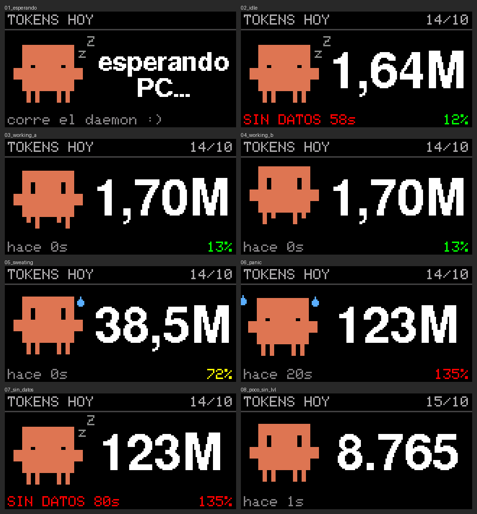

# token-dongle

Monitor de consumo de tokens de Claude Code en un **LILYGO T-Dongle-C5** (ESP32-C5): un daemon
lee `ccusage` y manda los datos por serial a la pantalla TFT, con el LED RGB como semáforo de gasto.

```
┌──────────────── PC (Debian 13) ─────────────────┐            ┌──── T-Dongle-C5 ────┐
│ ~/.claude/*.jsonl ──► ccusage daily --json      │  USB       │ HWCDC (Serial)      │
│                         │                       │  Serial/   │   │ JSON por línea  │
│ claude_token_daemon.py ─┴─► {"day_tokens":…}\n ─┼──JTAG────► │   ▼                 │
│   (systemd --user, cada 10 s)                   │            │ ST7735 80x160 + LED │
└─────────────────────────────────────────────────┘            └─────────────────────┘
```

- **Sin USB-HID**: el ESP32-C5 solo tiene USB Serial/JTAG, así que todo va por serie (CDC).
- **Sin API key**: `ccusage` lee los logs locales de Claude Code.



*Render de la pantalla (160x80, ampliada) con la misma librería gráfica del firmware.*

| Carpeta | Qué hay |
|---|---|
| [`daemon/`](daemon/README.md) | Script Python + servicio systemd + regla udev |
| [`firmware/`](firmware/README.md) | Proyecto PlatformIO para el dongle |
| [`statusline/`](statusline/README.md) | Status line de Claude Code que pasa los límites 5h/semana (opcional) |

## Qué necesitás

- Un **[LILYGO T-Dongle-C5](https://www.lilygo.cc/products/t-dongle-c5)** (ESP32-C5, el de pantalla 0.96").
  Ojo: **no** sirve el T-Dongle-S3, tiene otros pines.
- Una PC con **Linux** (probado en Debian 13; en cualquier distro con systemd debería andar).
- **Claude Code** instalado y usado en esa PC (de ahí salen los datos).
- Para las barras de límites: plan **Pro o Max** (opcional; sin eso funciona todo lo demás).

## Instalación desde cero

### 1. Clonar el repo

```bash
git clone https://github.com/maxi018/token-dongle ~/token-dongle
cd ~/token-dongle
```

> Clonalo en `~/token-dongle`: el servicio systemd usa esa ruta. Si lo ponés en otro lado,
> editá `ExecStart` en `daemon/claude-token-monitor.service`.

### 2. Dependencias de la PC

```bash
sudo apt install git python3 python3-venv python3-serial nodejs npm
sudo npm install -g ccusage
sudo usermod -aG dialout "$USER"      # después cerrá sesión y volvé a entrar
sudo cp daemon/99-t-dongle-c5.rules /etc/udev/rules.d/ && sudo udevadm control --reload && sudo udevadm trigger
```

### 3. Flashear el dongle

Enchufalo y buscá el puerto con `ls -l /dev/serial/by-id/` (suele ser `/dev/ttyACM0`).

**Opción A: firmware precompilado (lo más fácil)**

```bash
python3 -m venv ~/.venvs/esptool && ~/.venvs/esptool/bin/pip install esptool
~/.venvs/esptool/bin/esptool --chip esp32c5 --port /dev/ttyACM0 \
    write-flash 0x0 firmware/prebuilt/token-dongle-c5-factory.bin
```

**Opción B: compilarlo vos** (si querés tocar el código): ver [`firmware/README.md`](firmware/README.md).

Si no engancha: desenchufalo, mantené **BOOT** apretado, enchufalo, soltá y repetí.
Al terminar, desenchufá y volvé a enchufar. Tenés que ver el LED **rojo → verde → azul**
y a Clawd durmiendo con "esperando PC...".

### 4. Arrancar el daemon

```bash
./daemon/claude_token_daemon.py -v
```

A los ~10 segundos aparece tu consumo de hoy. Si funciona, dejalo como servicio para no
tener que acordarte más (arranca solo al iniciar sesión):

```bash
mkdir -p ~/.config/systemd/user
cp daemon/claude-token-monitor.service ~/.config/systemd/user/
systemctl --user daemon-reload && systemctl --user enable --now claude-token-monitor
```

### 5. (Opcional) Barras de límites 5h / semanal

```bash
python3 statusline/install.py
```

Abrí Claude Code, mandá un mensaje y en unos segundos aparecen las barras.
Detalles en [`statusline/README.md`](statusline/README.md).

### Si algo falla

| Síntoma | Solución |
|---|---|
| `Permission denied` en el puerto | no cerraste sesión después del `usermod` (chequeá con `groups`) |
| `Device or resource busy` | otro programa tiene el puerto: frená el daemon (`systemctl --user stop claude-token-monitor`) |
| Imagen dada vuelta | cambiá `TFT_ROTATION` a `3` en `firmware/src/main.cpp` y compilá (opción B) |
| Queda en "esperando PC" | corré el daemon con `-v` y fijate qué dice |
| Muestra 0 tokens | es normal si hoy todavía no usaste Claude Code en esta PC |

## Protocolo PC → dongle

Una línea JSON por mensaje, terminada en `\n`, máximo 512 bytes. El dongle ignora las claves
que no conoce, así que las fases nuevas pueden agregar campos sin romper firmwares viejos.

| Clave | Tipo | Fase | Descripción |
|---|---|---|---|
| `v` | int | 1 | versión del protocolo (`1`) |
| `day_tokens` | uint64 | 1 | total de tokens de hoy (`totalTokens` de `ccusage daily`) |
| `date` | `"YYYY-MM-DD"` | 1 | día al que corresponde |
| `lvl` | float | 2 | qué tan cerca del límite estás: maneja LED y humor de Clawd (`0.6` amarillo, `1.0` rojo). Opcional |
| `s5`, `s7` | int | 2 | % usado de la ventana de 5 h y de la semanal (límites oficiales Pro/Max). Opcional |
| `r5` | int | 2 | segundos hasta que resetea la ventana de 5 h. Opcional |
| `lim_age` | int | 2 | antigüedad de los límites en segundos (más de 30 min = barras grises). Opcional |

Si pasan más de 35 s sin mensajes válidos, el dongle muestra **SIN DATOS** en rojo.

## Fuente de datos

Verificado con **ccusage 20.0.31**:

- `ccusage daily --json --since YYYYMMDD --until YYYYMMDD` →
  `{"daily":[{"period":"2026-10-14","totalTokens":…,"totalCost":…,"inputTokens":…,"outputTokens":…,"cacheCreationTokens":…,"cacheReadTokens":…}],"totals":{…}}`
- `ccusage blocks --json --active` (ventana de 5 h, para la fase 2/3) →
  `{"blocks":[{"isActive":true,"startTime":…,"endTime":…,"totalTokens":…,"costUSD":…,"tokenCounts":{…},"burnRate":{"tokensPerMinute":…,"costPerHour":…},"projection":{"totalTokens":…,"totalCost":…,"remainingMinutes":…}}]}`

Ojo: en esta versión `daily` suma **todos** los agentes que detecta (campo `"agent":"all"`), no solo Claude Code.

## ¿Qué cuenta y qué no?

Hay dos fuentes distintas, y cuentan cosas distintas:

| | **Número grande** (ccusage) | **Barras 5h / sem** (status line) |
|---|---|---|
| Qué es | tokens que quedaron en los logs locales (`~/.claude`) de **esta PC** | el % oficial de tus límites, el mismo que `/usage` |
| Claude Code en la terminal de esta PC | ✅ | ✅ |
| Extensiones de VS Code / JetBrains en esta PC | ✅ (usan el mismo Claude Code) | ✅ cuentan; la barra se refresca seguro solo desde la terminal |
| claude.ai web, app de escritorio, celular | ❌ | ✅ cuentan para el límite, pero la barra se entera cuando vuelvas a usar la terminal |
| Claude Code en la web o en otra PC | ❌ (los logs quedan allá) | ✅ ídem |
| Otros agentes que ccusage detecta (ej. Codex) | ✅ los suma también | ❌ |

En resumen: el número es "cuánto laburó Claude Code en esta máquina" y las barras son "cuánto
te queda de verdad", porque los límites son compartidos entre todos los lugares donde usás Claude.

## Clawd y el semáforo

| Estado | Clawd | LED |
|---|---|---|
| Sin datos todavía | duerme (zZ) | azul respirando |
| Lejos del límite | tranqui, respira | verde → amarillo |
| Entraron tokens nuevos | camina y salta ~12 s | flash blanco |
| Cerca del límite | suda una gotita | amarillo → rojo |
| Límite al 90% o más (o presupuesto pasado) | tiembla y suda a mares | rojo latiendo rápido |
| Daemon sin mandar > 35 s | duerme, pie "SIN DATOS" en rojo | violeta respirando |

El semáforo sigue **el peor de tus límites reales** (5h o semanal): amarillo desde ~54% y rojo
desde 90%. Si no instalaste la status line (o no tenés plan Pro/Max), usa el presupuesto del
daemon (`--budget-usd`, default 50; o `--budget-tokens`). Con `--led-source budget` forzás el presupuesto.
El botón **BOOT** del dongle cicla el LED: normal → tenue → apagado.

## Hardware: dos cosas a saber

1. **El LED es un APA102, no un WS2812B.** Tiene clock (GPIO4) + data (GPIO5). Las libs de
   WS2812/NeoPixel no lo van a prender; el firmware lo maneja con un driver propio (`src/led.h`).
2. **Los pines no son los del T-Dongle-S3.** Están verificados contra el repo oficial
   [`Xinyuan-LilyGO/T-Dongle-C5`](https://github.com/Xinyuan-LilyGO/T-Dongle-C5); detalle en
   [`firmware/README.md`](firmware/README.md).

## Créditos y aclaraciones

- **Proyecto no oficial**, hecho por fans: no tiene relación con Anthropic ni con LilyGO.
  Claude, Claude Code y Clawd son de Anthropic; Clawd está dibujado a partir del logo ASCII del CLI.
- `firmware/boards/lilygo-t-dongle-c5.json` y el pinout salen del repo oficial
  [Xinyuan-LilyGO/T-Dongle-C5](https://github.com/Xinyuan-LilyGO/T-Dongle-C5).
- Datos de consumo: [ccusage](https://github.com/ccusage/ccusage).
- Licencia: [MIT](LICENSE).

## Roadmap

- [x] **Fase 1 (MVP)** — total de tokens del día en texto plano, actualizándose.
- [x] **Clawd** animado según el consumo + **semáforo** con el LED APA102.
- [x] **Barras de límites** 5h y semanal (oficiales, vía status line) + cuenta regresiva del reset.
- [ ] **Fase 2** — costo USD y burn rate en pantalla.
- [ ] **Fase 3** — barra de progreso de la ventana de 5 h y mini gráfico histórico.
